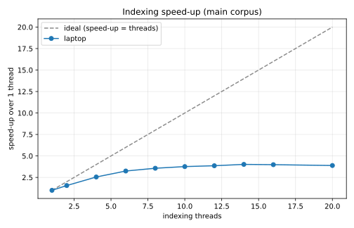

# Mini Search Engine

  

A search engine for English Wikipedia, written in C++23 from scratch: BM25 and TF-IDF ranking, a
multithreaded indexer, a compressed on-disk index that opens instantly with `mmap`, autocomplete,
"did you mean" spell correction, and an HTTP server with a small web UI. No search library is used.


*A screen capture of the web UI served by `msearch serve`. The timings it shows are not benchmark results.*

## Results

<!-- BEGIN generated:headline -->
Measured on: 12th Gen Intel(R) Core(TM) i7-12700H, 20 logical CPUs, 14Gi RAM, 7.0.0-43-generic, g++ 15.2.0. Profile `main`.

|  | Result | Benchmark |
|---|---|---|
| Corpus | 150,000 English Wikipedia articles, 1,513 MiB of text | B2 |
| Index size | 236 MiB with gap + VByte postings (15.6% of the text), against 705 MiB (46.6%) with raw postings; 2.18 bytes per posting | B2 |
| Indexing time | 26.7 s with 1 thread, 6.65 s with 14 threads (4.02x faster) | B1 |
| Opening the index | warm: `mmap` 0.016 ms, `read` 112 ms, `parse` 1,139 ms. Cold: `mmap` 0.842 ms, `read` 342 ms, `parse` 1,366 ms; but the first query after a cold `mmap` takes 20.8 ms (page faults), against 0.821 ms after a cold `parse` | B3 |
| Memory after opening | 4 MiB with `mmap`, 816 MiB with `parse` | B3 |
| Query latency (warm, one thread) | BM25 p50 0.097 ms, p95 2.14 ms; with result previews p50 0.518 ms, p95 2.57 ms | B4 |
| Ranking quality | MRR@10 0.890 for BM25, 0.594 for TF-IDF (1000 known-item queries; see Limitations) | B4 |
| Against `grep` | 113x to 368x faster for a one-word count (median 258x, 20 words); the index build is paid back after 6.1 queries | B5 |
| Spell check | BK-tree p50 12.7 ms against 34.0 ms for brute force (2.7x); the right word is suggested for 73% of 200 single-edit typos | B6 |
| Autocomplete | sorted term table p50 2.30 us, p95 25.9 us, nothing to build; trie p50 0.586 us but 364 ms to build and 216 MiB of memory | B7 |
<!-- END generated:headline -->

Every number above comes from a CSV file written by a benchmark in `bench/`, and this table is
generated from those files by `tools/make_readme.py`. The full tables, with ranges, are in
[benchmarks/RESULTS.md](benchmarks/RESULTS.md), and what each one means and where it can mislead is in
[benchmarks/NOTES.md](benchmarks/NOTES.md). Results that came out worse than hoped are reported as they
are: the BK-tree is only a modest speed-up over brute force, TF-IDF ranks far below BM25, and indexing
speeds up by much less than the number of threads.

### Indexing speed against thread count

<!-- BEGIN generated:scaling -->


| Threads | Build time (s), laptop | Speed-up |
|---|---|---|
| 1 | 26.7 | 1.00x |
| 2 | 17.2 | 1.56x |
| 4 | 10.5 | 2.55x |
| 6 | 8.22 | 3.25x |
| 8 | 7.48 | 3.57x |
| 10 | 7.10 | 3.76x |
| 12 | 6.91 | 3.86x |
| 14 | 6.65 | 4.02x |
| 16 | 6.70 | 3.98x |
| 20 | 6.87 | 3.89x |

Tokenizing scales (26.4 s with 1 thread, 5.08 s with 20), but the merge stage takes 1.31 to 1.61 s whatever the thread count. It runs in parallel, but each worker keeps its own list for almost every common term, so the work to combine them grows with the number of workers (exploratory measurements in [benchmarks/NOTES.md](benchmarks/NOTES.md)). That is a known limit of this design, and part of why the speed-up flattens. (`--memory-budget` selects a different build, a bounded-memory one with a single k-way merge, which is not part of this table.)

Only one machine (laptop) has been measured so far. Its 20 logical CPUs are 6 fast cores with two threads each plus 8 slower cores, so the curve flattens early; a run on a machine with uniform cores is planned and will be added here (see [docs/CLOUD.md](docs/CLOUD.md)).
<!-- END generated:scaling -->

## Quick start

Needs Linux (x86-64 or aarch64), `g++` 14 or newer, `cmake` 3.28+ and `ninja`. The first configure
downloads the pinned versions of GoogleTest, cpp-httplib and nlohmann/json.

```sh
cmake --preset release
cmake --build --preset release
```

**Try it at once on the 4-document test corpus** (no download):

```sh
build/release/msearch index tests/data/tiny_corpus -o /tmp/tiny.bin
build/release/msearch query -i /tmp/tiny.bin machine learning
build/release/msearch serve -i /tmp/tiny.bin --port 8080      # then open http://127.0.0.1:8080/
```

**On real Wikipedia text.** The `dev` profile (20,000 articles, a few minutes) is enough to try
everything; `main` (150,000 articles, about 1.5 GB of text, about 10 GB of disk at its peak) is the one
the results come from. WikiExtractor 3.0.6 needs Python 3.10
([why](docs/CLOUD.md)); `tools/cloud/run_on_new_machine.sh` sets that up for you.

```sh
python3 -m venv .venv && .venv/bin/pip install -r tools/requirements.txt
tools/fetch_wikipedia.sh dev                    # downloads and checks the dump files into data/raw/
for f in data/raw/*.bz2; do
  .venv/bin/python -m wikiextractor.WikiExtractor "$f" --json -o data/extracted/dev --processes "$(nproc)" --quiet
done
.venv/bin/python tools/prepare_corpus.py data/extracted/dev data/corpus/dev --max-docs 20000

build/release/msearch index data/corpus/dev -o data/index/dev.bin --threads auto
build/release/msearch query -i data/index/dev.bin "quantum mechanics"
build/release/msearch search -i data/index/dev.bin              # interactive; ":suggest alg" completes a word
build/release/msearch serve -i data/index/dev.bin --threads auto --port 8080
```

To index more text than fits in memory, give the build a memory budget and a folder for its temporary
files (they are removed when it ends, and need roughly as much disk as the index itself):

```sh
build/release/msearch index data/corpus/main -o data/index/main.bin --threads auto \
    --memory-budget 1G --tmp-dir /var/tmp/mse-runs
```

`--threads` takes a number or `auto` (all logical CPUs) for both `index` and `serve`. `serve` listens on
127.0.0.1 only; `--host 0.0.0.0` opens it to the network, and it has no TLS or authentication, so do that
only on a network you trust.

### HTTP API

| Request | Answer |
|---|---|
| `GET /api/search?q=<text>&k=<1..100>&rank=<bm25\|tfidf>` | `{"query", "corrected_query": null\|"...", "took_ms", "hits": [{"doc", "title", "score", "snippet", "highlights": [[offset, length]]}]}` |
| `GET /api/suggest?prefix=<text>` | `["completion", ...]` (up to 5, by document frequency; prefix of at least 2 letters) |
| `GET /` | the web page (`web/index.html`) |

A highlight is a byte range inside the UTF-8 `snippet`. A bad `k` or `rank` gets a `400` with
`{"error": "..."}`.

## How it works

```
 BUILD (msearch index)                              QUERY (msearch search / serve)

 data/corpus/part-*.tsv  (one article per line)     index.bin --mmap--> IndexView (nothing is parsed)
      |                                                  |
      v                                             query -> tokenize -> binary search in the term table
 scan lines: remember where each article is             |            (document frequency 0? ask the BK-tree:
      |                                                  |             "did you mean")
      v                                                  v
 T worker threads, batches claimed with an          decode VByte postings -> BM25 scores added up
 atomic counter: read, tokenize, build                   |
 per-worker  term -> [(doc, tf)]                         v
      |                                             top-k with a min-heap -> read k lines for snippets
      v
 merge the workers' lists, terms in sorted order
      |
      v
 IndexWriter: gap + VByte postings, term table, BK-tree
      -> index.bin.tmp -> fsync -> rename -> index.bin
```

The design decisions that matter, each measured in a benchmark:

- **A file you can search without reading it.** The index is a fixed binary layout
  ([docs/FORMAT.md](docs/FORMAT.md)): a sorted table of fixed-size term entries, so looking up a word is a
  binary search done in place in the mapped file. Opening it parses nothing, which is why `mmap` opens in
  microseconds where `parse` takes over a second (B3). The price is that the first queries after a cold start
  page the file in from disk.
- **Postings stored as gaps in VByte.** Document ids in a list are increasing, so the differences are small
  and fit in one byte most of the time. That makes the index much smaller than with raw postings (B2 has the sizes).
- **One `Searcher` per thread, one shared immutable view.** The `IndexView` never changes after opening, so
  any number of threads can read it. Each thread has its own `Searcher` because the score accumulator is
  scratch space that a search writes to. The HTTP server's concurrency test runs under ThreadSanitizer.
- **BM25 with tf-idf as the baseline.** BM25 (k1 = 1.2, b = 0.75) divides term frequency by a factor that
  grows with document length; the TF-IDF used here has no length term, and ranks long articles too high (B4).
- **Autocomplete from the term table, not a trie.** A trie is faster per query, but has to be built on every
  start and takes about as much memory as the index; the sorted table costs nothing. Both are implemented and
  measured (B7).
- **Spell check from a BK-tree stored in the index file.** Building it at startup would ruin the instant
  open, so it is built when the index is written. A brute-force version is the test oracle and the benchmark
  baseline (B6).
- **Safe writes and defensive reading.** The index is written to a temporary file, synced and renamed, so a
  crash never leaves half a file. Anything read from outside (files, the index, queries, HTTP parameters)
  returns an error instead of crashing, and damaged index files are covered by tests.
- **A memory budget by spilling sorted runs (SPIMI).** With `--memory-budget`, each worker counts postings in
  memory until it reaches its share of the budget, then sorts them and writes a run file; one k-way merge with a
  heap then streams every term, in order, into the same `IndexWriter` the in-memory build uses. The output is
  byte-identical to the in-memory build for any thread count and any budget (a test builds the same corpus both
  ways and compares the files). The budget pays first for the document table and some memory per thread.
- **No text in the index.** Snippets are read from the corpus files with `pread`, `k` lines per query. This
  keeps the index small, and means the corpus folder has to be there when searching (or given with `--corpus`).

## Method

- Every number comes from a benchmark in `bench/`, run through `tools/run_benchmarks.sh`, which writes a CSV
  with the machine name and the git commit of the code that ran (marked `-dirty` if it had uncommitted changes).
  The tables are generated from the CSVs; nothing is typed by hand.
- Release builds only; the benchmark program refuses to run otherwise. Each load measurement is a fresh process.
  Timings are the median of 5 runs after one that is discarded; percentiles are nearest-rank.
- Cold means the file was evicted from the page cache first; the cold numbers are checked (a cold `mmap` run
  with no page faults aborts the benchmark).
- Ranking quality is measured with known-item queries: the title of a random article, with the article as the
  right answer.
- Setup and caveats for every benchmark are in [benchmarks/NOTES.md](benchmarks/NOTES.md).

## Limitations

- **The ranking numbers are optimistic.** The queries are article titles, and titles are indexed, so every
  query word is in the right article. Real queries do not guarantee that. MRR@10 compares BM25 with TF-IDF on
  this task; it is not a judgement of search quality on real information needs.
- **By default the index is built in memory.** Peak memory while building is in the B1 table of RESULTS.md and
  grows with the corpus. For a corpus that does not fit, `--memory-budget` selects a bounded-memory build (see
  below), which writes sorted pieces to disk and merges them with one sequential k-way merge. It makes the
  same file, but it is not a faster build.
- **Indexing does not scale with the number of threads.** The speed-up table above shows it. The merge stage
  does not get faster with more threads (see above), and the laptop's cores are not all alike. Only one machine
  has been measured.
- **Spell check is plain edit distance.** A swap of two neighbouring letters costs 2, so "theroy" can be
  corrected to "theron" (1 edit) instead of "theory". It only corrects words that are in no document, so a typo
  that happens to be a real word is left alone. The accuracy in the results table is below 100% on
  single-edit typos of common words (B6).
- **Not implemented:** phrase queries and word positions, stemming, incremental updates and deletes, early
  termination (WAND / MaxScore), Windows.
- **The server is minimal:** `GET` only, no TLS, no authentication, and it listens on 127.0.0.1 unless told
  otherwise.

## Tests and sanitizers

```sh
tools/check_all.sh          # builds and tests debug, asan (ASan + UBSan), tsan and release
ctest --preset release      # just one
```

CI builds and tests the `release`, `asan` and `tsan` presets on x86-64 and on ARM for every push
([.github/workflows/ci.yml](.github/workflows/ci.yml)). The tests include a brute-force oracle for the spell
check, damaged index files, and eight client threads hitting the HTTP server at once.

## Reproduce the benchmarks on your own machine

```sh
tools/cloud/run_on_new_machine.sh my-machine main --threads 1,2,4,8,16,32
```

It builds, tests, downloads and prepares the corpus, runs B1 to B7 and packs the CSVs into a tarball; see
[docs/CLOUD.md](docs/CLOUD.md). To regenerate the tables and this page after adding results:

```sh
.venv/bin/python tools/make_results.py benchmarks/results > benchmarks/RESULTS.md
.venv/bin/python tools/plot_scaling.py benchmarks/results docs/img/scaling.svg
python3 tools/make_readme.py README.md benchmarks/results
```

## License

MIT, see [LICENSE](LICENSE).

## Layout

| Path | What is in it |
|---|---|
| `src/` | the library: tokenizer, indexer, index file reader and writer, rankers, searcher, autocomplete, BK-tree, snippets, HTTP server |
| `app/` | the `msearch` command line |
| `web/index.html` | the web UI, one file, no dependencies |
| `bench/`, `tools/`, `benchmarks/` | the benchmark program, the scripts that run it, and its results |
| `tests/` | the unit and integration tests |
| `docs/FORMAT.md` | the index file format |
